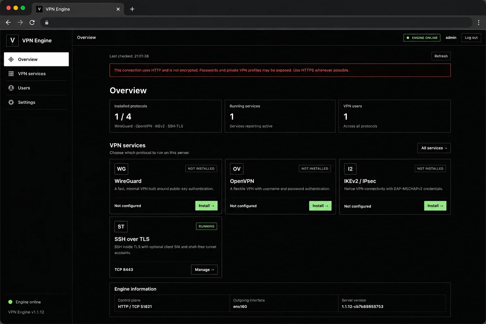
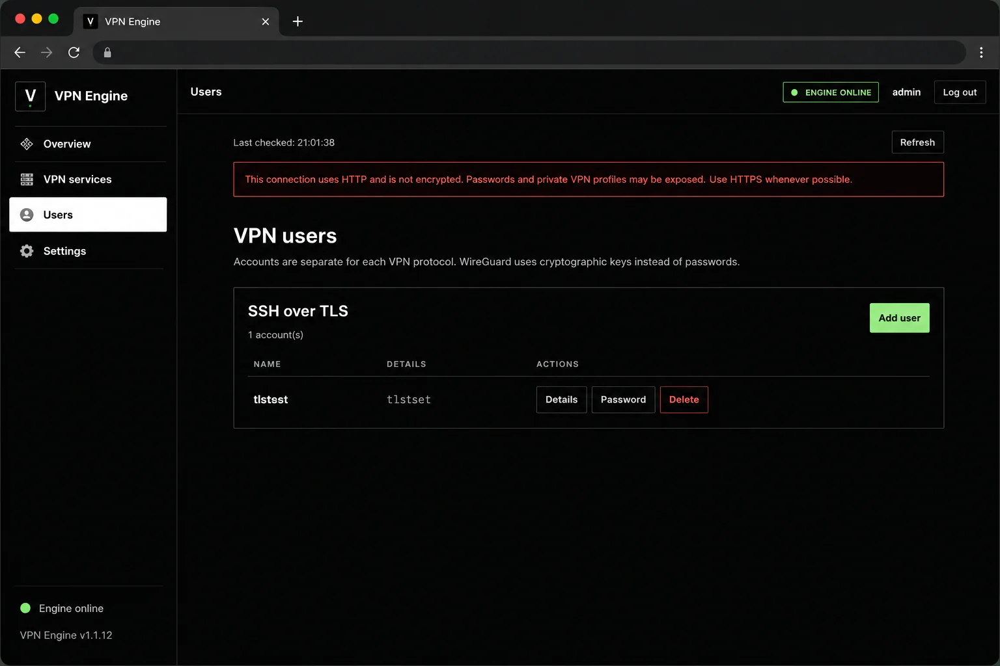
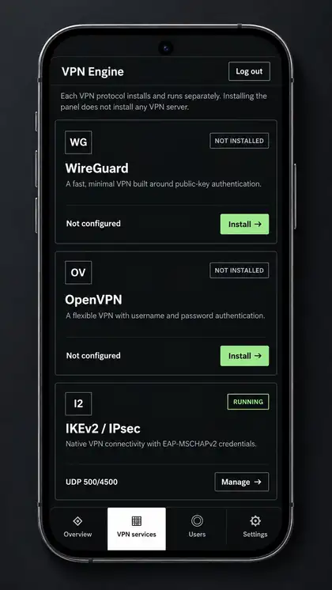
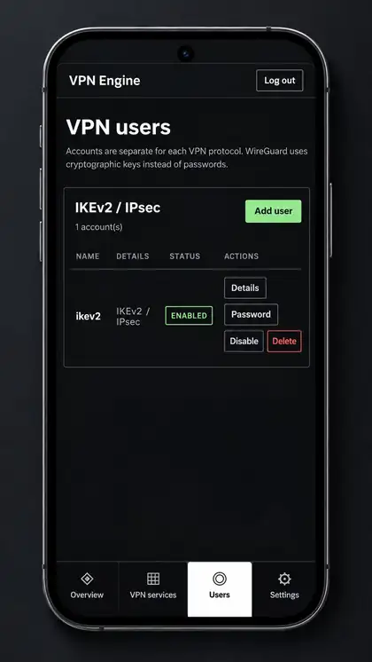

# VPN Engine

VPN Engine is a self-hosted web panel for installing and managing WireGuard, OpenVPN, IKEv2/IPsec and SSH over TLS on a Linux server.

Each service is installed and managed separately. The panel handles server configuration, user accounts, client profiles and service management.

## Screenshots

### Desktop





### Mobile

<p align="center">
  
  
</p>

## Features

- Install, start, stop, restart and remove services independently.
- Create and delete user accounts, and change passwords for password-based services.
- Download WireGuard configurations and scan QR codes.
- Download OpenVPN profiles and IKEv2 CA certificates.
- Configure VPN ports, subnets and DNS settings.
- Enable IPv6 separately for WireGuard, OpenVPN and IKEv2 when available.
- View installation progress, service status and logs.
- Manage administrator credentials and sessions.
- Configure HTTPS automatically when certificate issuance succeeds.

## Supported services

| Service | Authentication | Default port |
| --- | --- | --- |
| WireGuard | Public/private keys | UDP 123 |
| OpenVPN | Username and password | UDP 1194 |
| IKEv2/IPsec | EAP-MSCHAPv2 | UDP 500, 4500 |
| SSH over TLS | Username and password | TCP 8443 |

Services have separate configurations and accounts. Install only the ones you need.

## Requirements

**Supported operating systems:** Ubuntu 24.x, Ubuntu 26.x, Debian 12 and Debian 13.

**Architectures:** AMD64 (x86_64) and ARM64 (aarch64).

The server must have root access, systemd, an APT package manager and IPv4 connectivity. A public IPv4 address and available inbound TCP ports 80 and 443 are required for automatic HTTPS certificate setup.

## Installation

Run as root:

```bash
curl -fsSL https://raw.githubusercontent.com/yulcaribe/vpnengine/main/install.sh | bash
```

The installer downloads the current GitHub `main` commit, compiles VPN Engine on the server and configures the management panel. It handles the Go toolchain automatically and installs VPN services separately through the panel.

### Access the panel

When HTTPS is configured successfully, open:

```text
https://SERVER_IP
```

The installer uses nginx and Let's Encrypt for HTTPS. If certificate setup fails, it falls back to direct HTTP on the configured backend port (TCP `51821` by default):

```text
http://SERVER_IP:51821
```

**HTTP is not encrypted.** Do not enter passwords or transfer private VPN profiles over untrusted HTTP connections. Restrict access until HTTPS is available.

On first access, create an administrator username and password. Anyone who can reach an uninitialized panel can claim the first administrator account, so complete setup promptly.

## Web panel

| Section | Purpose |
| --- | --- |
| Overview | Installed services, running services and user counts |
| VPN services | Protocol installation, configuration, controls and logs |
| Users | User accounts, credentials and client profiles |
| Settings | Administrator settings and server IPv6 connectivity |

### WireGuard

WireGuard uses key-based authentication. VPN Engine creates a dedicated `vpnwg0` interface and assigns a VPN address to each device.

Download the WireGuard `.conf` profile or scan its QR code to import it into a compatible client.

### OpenVPN

OpenVPN uses username and password authentication. Download the generated `.ovpn` profile and import it into an OpenVPN client. Enter the assigned username and password when connecting.

### IKEv2/IPsec

IKEv2 uses strongSwan with EAP-MSCHAPv2 authentication. Download the generated CA certificate and install it on the client device before connecting.

Typical native client settings:

```text
VPN type: IKEv2/IPsec MSCHAPv2
Server: Server IP or domain
Username: VPN Engine username
Password: VPN Engine password
```

### SSH over TLS

SSH over TLS uses OpenSSH and stunnel4 to provide SSH connections through TLS.

The default TLS port is TCP `8443` and can be changed during installation. SSH-TLS runs separately from the administrator SSH service.

Client settings:

```text
Server: Server IP or domain
Port: 8443 (TCP)
Username: VPN Engine username
Password: VPN Engine password
SNI: Optional
```

SSH-TLS accounts support TCP forwarding. Shell access, command execution and SFTP are disabled. SSH over TLS does not provide UDP tunneling.

## IPv6

WireGuard, OpenVPN and IKEv2 support optional IPv6 connectivity. Each service can use IPv6 when the server has working IPv6 internet access; the panel checks this under **Settings**.

After changing IPv6 settings, reconnect your devices. WireGuard and OpenVPN clients should import updated profiles. Check routing and IPv6 behavior on the actual client device.

## Network ports

Allow the ports required by the installed services in both the server firewall and the VPS provider firewall.

| Service | Protocol | Port |
| --- | --- | --- |
| HTTPS panel | TCP | 443 |
| HTTP / certificate validation | TCP | 80 |
| WireGuard | UDP | 123 (default) |
| OpenVPN | UDP | 1194 (default) |
| IKEv2/IPsec | UDP | 500, 4500 |
| SSH over TLS | TCP | 8443 (default) |

WireGuard, OpenVPN and SSH-TLS ports are configurable at installation. The admin backend uses TCP `51821` by default and binds to localhost when HTTPS succeeds.

VPN Engine configures forwarding and NAT for its managed VPN networks. Provider-side firewall rules must be configured separately.

## Updating

Run the installation command again:

```bash
curl -fsSL https://raw.githubusercontent.com/yulcaribe/vpnengine/main/install.sh | bash
```

Updates build the current GitHub `main` commit. The installer preserves installed VPN services, active accounts, profiles, keys and settings, and includes a rollback mechanism for panel installation failures. Back up your configuration before major changes.

## Uninstalling

Run as root:

```bash
curl -fsSL https://raw.githubusercontent.com/yulcaribe/vpnengine/main/uninstall.sh | bash
```

This removes the panel, its managed services, VPN Engine accounts, private configuration and certificates, and its associated network rules. Shared system packages are retained.

**Uninstallation deletes VPN Engine data.** Back up anything you need first.

## Service management

Check the panel service:

```bash
systemctl status vpn-engine
```

View recent logs:

```bash
journalctl -u vpn-engine -n 100 --no-pager
```

Individual VPN services can be managed and inspected from the web panel.

## File locations

| Path | Description |
| --- | --- |
| `/usr/local/bin/vpn-engine` | Application binary |
| `/etc/vpn-engine/` | VPN Engine configuration and data |
| `/etc/vpn-engine/state.json` | Panel settings, services and user records |
| `/etc/wireguard/vpnwg0.conf` | WireGuard server configuration |
| `/etc/openvpn/server/vpnengine.conf` | OpenVPN server configuration |
| `/etc/swanctl/conf.d/vpn-engine.conf` | IKEv2 server configuration |
| `/etc/vpn-engine/sshtls/` | SSH over TLS configuration |

The configuration directory contains passwords or password-derived data, credentials and private keys. Restrict access and protect backups.

## Development

VPN Engine is written in Go with an HTML, CSS and JavaScript web interface.

Run repository checks:

```bash
go test -race ./...
go vet ./...
bash -n install.sh uninstall.sh
node --check web/app.js
```

Automated tests do not replace connectivity tests with real VPN clients.

## License

[MIT License](LICENSE)

## Issues and contributions

Report bugs, request features or submit pull requests through GitHub. Include the affected service, system version and relevant logs. Remove passwords, private keys and session credentials from logs before posting.
